# NYC311 Service Channel and Requester Behavior Analytics System

## 1. Introduction

This project implements an end-to-end analysis of how New Yorkers contact the city's 311 service, built on 22,703,288 service requests from January 2020 to October 2026. PostgreSQL handles the data model and analytical SQL, R the statistical inference, and Python the machine learning, forecasting and model monitoring. The data layer is also built a second time in Spark SQL on a partitioned Hive table and checked row by row against PostgreSQL.

311 takes requests by phone, through the website and through a mobile app. The project asks five questions:

1. How has the channel mix changed, and where?
2. What decides whether a request arrives digitally or by phone: the complaint, the place, the time, or the requester's own history?
3. Does the channel change how fast a request gets closed?
4. Can we predict which requests will come in by phone, so they can be steered to digital channels?
5. How many phone requests will the call center get over the next four weeks?

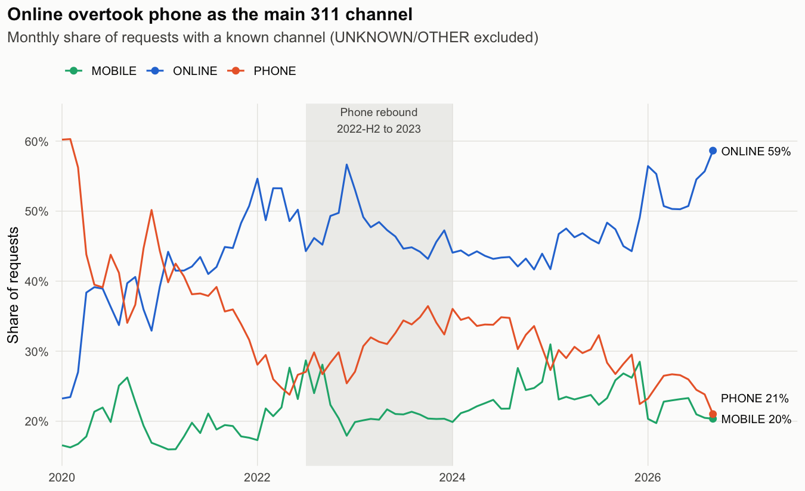

| | |
|---|---|
| Channel shift | Phone share fell from 44.5% (2020) to 24.8% (January to September 2026) |
| Phone request model (2025 to 2026, never seen in training) | LightGBM AUC 0.877; the top 10% of requests by predicted phone probability hold 35% of all phone requests |
| Drift response | Rolling Platt recalibration cut the calibration gap from -4.6 to -0.6 points on the 2026 holdout |
| Call-center forecast | 28 days ahead, WAPE 12.2% against 13.2% for a seasonal naive forecast |
| Spark and Hive parity | 2,036,003 rows of the ML sample match PostgreSQL in every column |

The headline result is not the AUC. "Mobile requests close faster" turns out to be a Simpson's paradox: within the same complaint type the gap disappears, and phone looks slow only because it carries more housing complaints (Section 9.5).

**Core Features:**
- PostgreSQL raw, core and mart layers with yearly range partitions and idempotent scripts
- Analytical SQL with CTEs, window functions (`LAG`, `ROW_NUMBER`, `NTILE`, running frames), `FILTER`, `PERCENTILE_CONT` and direct standardization
- Hypothesis tests that report an effect size next to every p-value (Cramér's V, epsilon squared, a difference in points with its CI)
- Grouped binomial logistic regression on 17.2M requests in 16,710 cells
- Survival analysis with censored open requests: Kaplan-Meier, log-rank, Cox regression and a proportional hazards check
- Address history features built with backward-looking window functions, so the target never leaks into them
- LightGBM channel model with time-based validation, ablation, calibration and cumulative gain
- Monthly batch scoring into PostgreSQL with PSI and calibration-gap monitoring
- Champion/challenger retraining with a model registry and a promotion rule
- 28-day direct LightGBM phone demand forecast with a rolling-origin backtest and an 80% interval
- The same data layer rebuilt in PySpark and Spark SQL on a Hive table `PARTITIONED BY (yr)`, with parity checks against PostgreSQL

## 2. Methodology / Approach

Each layer has one tool. SQL builds the data and the aggregates, R runs the statistics on those aggregates, and Python trains, scores and monitors the models. Spark repeats the data layer to show that the same queries and the same partitioned layout work in Spark SQL and Hive.

### 2.1 System Architecture

| Layer | Tool | What it does |
|---|---|---|
| Data engineering | PostgreSQL 18 | Loads a 16 GB CSV into raw, core and mart layers; yearly range partitions with partition pruning; idempotent scripts |
| Analytical SQL | PostgreSQL | CTEs, window functions (`LAG`, `ROW_NUMBER`, `NTILE`, running frames), `FILTER`, `PERCENTILE_CONT`, direct standardization |
| Statistics | R | Chi-square with Cramér's V, two-proportion test, Kruskal-Wallis with epsilon squared, grouped logistic regression, Kaplan-Meier, Cox regression |
| Machine learning | Python | sklearn pipeline, LightGBM, time-based validation, ablation, calibration, demand forecasting, batch scoring, drift monitoring, champion/challenger retraining |
| Big data | PySpark 4.2, Spark SQL, Hive metastore | CSV to Parquet, Hive table `PARTITIONED BY (yr)`, the channel marts and the window-function history rebuilt in Spark SQL, parity checks against PostgreSQL |

The data model:

```
CSV (16 GB, 44 columns)
  │  \copy into an UNLOGGED table, every column TEXT
  ▼
raw.service_requests            22,703,288 rows, 15 GB
  │  types, cleaning rules, dropped duplicate columns
  ▼
core.service_requests           PARTITION BY RANGE (created_at), one partition per year
  │  core.v_requests view: year, hour, weekday, is_digital, complaint_family, requester_key
  ▼
mart.daily_channel_volume       7,395 rows
mart.monthly_channel            243 rows
mart.segment_channel            57,154 rows
mart.heat_survival              580,695 rows
mart.request_history            20,354,110 rows (UNLOGGED)
mart.ml_requests                2,036,003 rows
mart.channel_scores             scoring output, one batch per month and model version
```

### 2.2 Implementation Strategy

- The raw layer is UNLOGGED. It can be rebuilt from the CSV at any time, so writing it to the write-ahead log would only slow the load.
- Yearly partitions mean a query filtered on 2025 scans only the 2025 partition. The `EXPLAIN` at the end of `01_ingest.sql` shows this. Hive tables partitioned by year work the same way.
- The core table is vacuumed right after the bulk insert, and the primary key and indexes are built after that. The vacuum writes hint bits and the visibility map in one pass, so the index builds do not have to, and yearly counts run as index-only scans from the start.
- Derived fields live in a view instead of new columns, which avoids an `UPDATE` over 22.7M rows.
- The window functions behind the requester history need one large sort. They run once, and every later analysis and the ML sample read the stored result.
- R works on aggregates instead of raw rows. The logistic regression uses a grouped binomial GLM.
- The ML sample (`unique_key % 10 = 0`) is deterministic and reproducible. Scoring always runs on the full month.
- History features look only backwards (`ROWS BETWEEN UNBOUNDED PRECEDING AND 1 PRECEDING`), so the target never leaks into them. The one column that looks forward, `req_total`, is used only to filter heavy requesters.
- Training and scoring call the same `prepare_features` in `python/common.py`, so the features seen in production match the features seen in training.
- Everything that trains or samples reads its rows `ORDER BY unique_key`, LightGBM runs with `deterministic=True`, and R sorts before `slice_sample`. PostgreSQL returns unordered rows in whatever order the scan produces, and bagging, the logistic regression solver and random samples all depend on that order. A rebuild from the CSV reproduces every result table in `outputs/tables` byte for byte; only `Pipeline-Run-Times.csv` changes from run to run.
- Models are saved one file per version. `outputs/models/registry.json` records which version is active and which one it replaced, so re-running training never demotes a promoted model.
- `config/palette.json` holds the chart colors for both R and Python, so a channel has the same color in every figure: blue for online, aqua for mobile, orange for phone, violet for the main model. The palette passed a color-vision-deficiency check.

### 2.3 Spark and Hive

The `spark/` scripts rebuild the data layer with PySpark in local mode and compare every result with PostgreSQL. `spark/session.py` holds the session setup and the comparison helper, which joins both result sets on their keys and reports rows found on one side only and mismatched values.

| Check | Rows compared | Result |
|---|---|---|
| Rows per year | 7 | match |
| Cleaning rules: valid durations, total resolution hours, NULL counts | 8 measures | match |
| Derived fields: channel x complaint family, distinct requesters | 59 | match |
| `mart_daily_channel_volume` | 7,395 | match |
| `mart_monthly_channel` (window `SUM` share, `ROWS 11 PRECEDING` rolling mean) | 243 | match |
| `mart_segment_channel` | 57,154 | match |
| Yearly share with `LAG`, top 3 per channel with `ROW_NUMBER` | 7 + 9 | match |
| Requester concentration (`NTILE`), transition matrix, history segments | 1 + 9 + 5 | match |
| 10% ML sample, every column of every row | 2,036,003 | match |

| Step | PostgreSQL | Spark (local, 10 cores) |
|---|---|---|
| CSV to typed, partitioned table | 548 s: `\copy` 113 s, typed insert 314 s, `VACUUM` 31 s, primary key and three indexes 77 s | 49 s for the 16 GB CSV, written as 1.31 GB of Parquet in 127 files |
| `segment_channel` mart | 17.3 s | 2.3 s |
| Requester history (one sort of 20.4M rows, four window functions) | 55.3 s | 61.6 s |
| `COUNT(*)` for one year | partition pruning, index-only scan | 0.1 s, `PartitionFilters: [yr = 2025]` |

The parity checks found two real differences on the first run, both fixed:

1. The existing core table also sets the zip code `00000` to NULL (7 rows). `sql/01_ingest.sql` did not have that rule, so a rebuild from the CSV would not have matched. Both engines now apply it.
2. Three addresses contain mis-encoded characters (`â`). PostgreSQL runs with the C collation, whose `upper()` changes only ASCII letters, while Spark's `upper()` follows Unicode and turned `â` into `Â`. That split two requester keys. The Spark script now upper-cases ASCII only, through `translate`.

Spark runs on one machine here. Moving to a cluster changes the master URL and the warehouse path, not the queries.

## 3. Mathematical Framework

### 3.1 Cramér's V

Association between channel and a categorical variable (borough or complaint family) in an $r \times c$ table with $n$ requests:

$$V = \sqrt{\frac{\chi^2}{n(\min(r, c) - 1)}}$$

With millions of rows almost every chi-square test gives $p \approx 0$, so $V$ is the number that is compared.

### 3.2 Kruskal-Wallis Effect Size

Resolution time by channel within one complaint type, 20,000 requests per channel. With $H$ the Kruskal-Wallis statistic and $n$ the sample size:

$$\varepsilon^2 = \frac{H}{n - 1}$$

Pairwise Wilcoxon tests use the Holm correction.

### 3.3 Direct Standardization

Every channel $c$ gets the same weights $w_t$, the total volume of complaint type $t$, so a gap that remains belongs to the channel and not to its complaint mix. With $p_{c,t}$ the share closed within 7 days:

$$P^{\text{std}}_c = \frac{\sum_t w_t p_{c,t}}{\sum_t w_t}$$

Only types with at least 500 requests on all three channels are included.

### 3.4 Kaplan-Meier and Cox Regression

Requests that are still open are censored instead of dropped. With $d_i$ closures and $n_i$ requests still open just before time $t_i$:

$$\hat{S}(t) = \prod_{t_i \le t} \left(1 - \frac{d_i}{n_i}\right)$$

The Cox model compares channels after adjusting for borough, weekend, time band and year:

$$h(t \mid x) = h_0(t) \exp(\beta^\top x), \quad \text{HR}_j = e^{\beta_j}$$

Here a hazard ratio above 1 means the request closes faster. Proportional hazards are checked with Schoenfeld residuals (`cox.zph`).

### 3.5 Grouped Logistic Regression

The probability that a request arrives digitally (online or mobile) instead of by phone:

$$\log \frac{P(\text{digital})}{1 - P(\text{digital})} = \beta_0 + \beta^\top x, \quad \text{OR}_j = e^{\beta_j}$$

Fitting `cbind(digital, phone) ~ x` on cells gives the same coefficients as one row per request with the same covariates. Fit is measured with McFadden's pseudo-$R^2$ on the request-level log-likelihood:

$$R^2_{\text{McF}} = 1 - \frac{\ell(M)}{\ell(M_0)}$$

### 3.6 Address History Features

For request $k$ of requester $a$, ordered by time, only earlier requests are used:

$$n_{a,k} = k - 1, \quad r_{a,k} = \frac{1}{k - 1} \sum_{j < k} d_{a,j}$$

Here $n_{a,k}$ is `prior_n`, $r_{a,k}$ is `prior_digital_rate` and $d_{a,j}$ is `is_digital` (1 for an online or mobile request, 0 for phone). `prev_channel` and `days_since_prev` come from `LAG` over the same window.

### 3.7 Monitoring and Recalibration

The calibration gap, in percentage points, between the mean predicted digital probability $\hat{p}$ and the actual digital share $y$:

$$\text{gap} = 100 \left(\bar{\hat{p}} - \bar{y}\right)$$

The population stability index of the score distribution, with bins set at the deciles of the reference month ($r_i$ reference share, $c_i$ current share):

$$\text{PSI} = \sum_i (c_i - r_i) \ln \frac{c_i}{r_i}$$

An alert is raised when PSI > 0.2 or |gap| > 3 points. Platt recalibration fits a one-feature logistic regression on the model's log-odds:

$$\hat{p}' = \sigma\left(a \cdot \text{logit}(\hat{p}) + b\right)$$

The rolling version refits $a$ and $b$ each month $m$ on months $m-3$ to $m-1$.

### 3.8 Demand Forecast

The target is the deviation from the recent level, so the trees never need to extrapolate to a level they have not seen. With $L_t$ the mean of $\log(1 + y)$ over the 28 days ending 28 days before $t$:

$$z_t = \log(1 + y_t) - L_t, \quad \hat{y}_t = \exp(\hat{z}_t + L_t) - 1$$

Accuracy is measured with the weighted absolute percentage error:

$$\text{WAPE} = 100 \cdot \frac{\sum_t |\hat{y}_t - y_t|}{\sum_t y_t}$$

The 80% interval multiplies the forecast by the 10th and 90th percentiles of the backtest ratio $y_t / \hat{y}_t$.

## 4. Dataset

### 4.1 Source

The NYC Open Data [311 Service Requests from 2020 to Present](https://data.cityofnewyork.us/Social-Services/311-Service-Requests-from-2020-to-Present/erm2-nwe9) export, saved as `data/csv/nyc311_service_requests.csv`.

| Property | Value |
|---|---|
| Requests | 22,703,288 |
| Period | January 2020 to October 2026 (October holds five days) |
| Columns | 44 |
| CSV size | 16 GB |
| Channel field | `open_data_channel_type`: PHONE, ONLINE, MOBILE, UNKNOWN, OTHER |

### 4.2 Data Quality

`sql/02_data_quality.sql` measures the problems before any analysis uses the data:

| Check | Result |
|---|---|
| Missing values (%) | closed date 1.93, borough 0.35, zip 1.40, coordinates 1.87, location type 13.08, BBL 11.72 |
| Unknown channel | 8.61% of all requests; 81% of them come from two agencies (all of DOB, 60.4% of DOT) |
| Closed before created | 47,160 requests, duration set to NULL |
| Closed in the future | 2 requests, duration set to NULL |
| Partial period | October 2026 has five days and is left out of trends and forecasts |
| Spelling variants | `RESIDENTIAL BUILDING` / `Residential Building` and five ways of writing `1-2 Family Dwelling` |
| Heaviest requester | one Bronx building with 241,725 requests (1.1% of the dataset) |

`sql/01_ingest.sql` applies the cleaning rules: invalid durations become NULL, zip codes that are not five digits (or are `00000`) become NULL, borough `Unspecified` becomes NULL, coordinates outside the NYC bounding box become NULL, and duplicated or almost empty columns are dropped.

### 4.3 Requester Key

The dataset has no person ID. `requester_key` is the building (BBL), or the zip code plus the upper-cased address when the BBL is missing. 1,008,261 requester keys file 20,354,110 requests with a known channel; 24.8% of them file only once.

## 5. Model

**Channel model:** `outputs/models/channel_lgbm_v2.joblib` (active), replacing `channel_lgbm_v1`  
**Task:** binary classification, digital (online or mobile) vs phone  
**Algorithm:** LightGBM, 127 leaves, learning rate 0.05, early stopping after 50 rounds, seed 42  
**Features:** agency, complaint type, complaint family, location type, borough, hour, weekday, weekend, month, and four address history features (`prev_channel`, `log_prior_n`, `days_since_prev`, `prior_digital_rate`)  
**Excluded on purpose:** year, because trees cannot extrapolate to an unseen year; the trend is handled by monitoring and recalibration  
**Input:** `mart.ml_requests`, a deterministic 10% sample (2,036,003 rows)

| Version | Trained on | Calibration | Evaluation | ROC AUC | Log loss | Brier |
|---|---|---|---|---:|---:|---:|
| `channel_lgbm_v1` | 2020 to 2023, early stopping on 2024 | none | 2025-01 to 2026-09 | 0.877 | 0.366 | 0.117 |
| `channel_lgbm_v2` | 2020-01 to 2025-06, early stopping on 2025-H2 | rolling Platt, refit on 2026-06 to 2026-08 | 2026-01 to 2026-09 | 0.883 | 0.344 | 0.109 |

**Demand model:** direct 28-day LightGBM regression on the daily phone series (`mart.daily_channel_volume`), L1 objective, 600 rounds. Features are lags at 28, 35, 42 and 364 days relative to the recent level, weekday, month, day of year and US federal holidays.

## 6. Requirements

`requirements.txt`

```txt
pandas==2.3.3
numpy==2.5.3
scikit-learn==1.9.0
lightgbm==4.6.0
matplotlib==3.11.2
SQLAlchemy==2.0.39
psycopg2-binary==2.9.13
joblib==1.6.0
pyspark==4.2.0
```

Outside Python, the project needs:

- PostgreSQL 18
- R 4.x with DBI, RPostgres, dplyr, tidyr, purrr, readr, ggplot2, scales, forcats, broom, survival and jsonlite
- Java 17 for Spark (`brew install openjdk@17`; `spark/session.py` sets `JAVA_HOME`)

## 7. Installation & Configuration

### 7.1 Environment Setup

```bash
# Clone the repository
git clone https://github.com/kemalkilicaslan/NYC311-Service-Channel-and-Requester-Behavior-Analytics-System.git
cd NYC311-Service-Channel-and-Requester-Behavior-Analytics-System

# Install Python packages
pip install -r requirements.txt

# Install R packages
Rscript -e 'install.packages(c("DBI", "RPostgres", "dplyr", "tidyr", "purrr", "readr", "ggplot2", "scales", "forcats", "broom", "survival", "jsonlite"))'

# The password is never written in code: libpq reads it from ~/.pgpass
printf 'localhost:5432:*:postgres:YOUR_PASSWORD\n' > ~/.pgpass && chmod 600 ~/.pgpass
```

### 7.2 Project Structure

```
NYC311-Service-Channel-and-Requester-Behavior-Analytics-System/
├── sql/
│   ├── 01_ingest.sql              # database, raw (UNLOGGED, TEXT) and core (typed, partitioned by year)
│   ├── 02_data_quality.sql        # core.v_requests view, data quality report
│   ├── 03_channel_mix.sql         # channel marts, LAG / ROW_NUMBER queries
│   ├── 04_resolution_time.sql     # stratified and standardized resolution, mart.heat_survival
│   └── 05_requester_behavior.sql  # mart.request_history, mart.ml_requests
├── R/
│   ├── 00_setup.R                 # packages, connection, palette, ggplot theme
│   ├── 01_channel_mix.R           # channel mix figures
│   ├── 02_hypothesis_tests.R      # chi-square, Cramér's V, proportion test, Kruskal-Wallis
│   ├── 03_channel_choice_model.R  # grouped logistic regression, odds ratio figure
│   └── 04_survival.R              # Kaplan-Meier, log-rank, Cox, survival figure
├── python/
│   ├── common.py                  # connection, features, model registry
│   ├── 01_channel_model.py        # baseline, logistic regression, LightGBM, ablation
│   ├── 02_phone_forecast.py       # 28-day phone forecast with backtest
│   ├── 03_batch_scoring.py        # monthly scoring and monitoring
│   └── 04_retrain.py              # champion/challenger retraining
├── spark/
│   ├── session.py                 # Spark session, PostgreSQL parity helper
│   ├── 01_csv_to_parquet.py       # Hive table partitioned by year
│   ├── 02_channel_mix.py          # channel marts in Spark SQL
│   └── 03_requester_history.py    # requester history and ML sample in Spark SQL
├── config/palette.json            # chart colors shared by R and Python
├── data/                          # CSV, Spark warehouse, Hive metastore (not tracked)
├── outputs/
│   ├── tables/                    # every result table as CSV, plus Pipeline-Run-Times.csv
│   ├── models/registry.json       # active model and version history
│   └── logs/                      # one log per script run (sql_*, R_*, python_*, spark_*)
├── NYC311-Service-Channel-and-Requester-Behavior-Analytics-*.png   # the 11 README figures
├── run_all.sh                     # runs all 17 steps; --fresh rebuilds from the CSV
├── run_sql.sh                     # runs one SQL script with psql and logs the output
├── NYC311-Service-Channel-and-Requester-Behavior-Analytics-System.Rproj
├── .gitignore                     # data/, model files, R and Python caches, Spark metastore
├── requirements.txt
├── README.md
└── LICENSE
```

### 7.3 Required Files

- **Data:** the 311 CSV in `data/csv/nyc311_service_requests.csv` (Section 4.1).
- **Database:** a local PostgreSQL 18 server. `sql/01_ingest.sql` creates the `nyc311` database itself.

### 7.4 Configuration Parameters

The connection is read from environment variables, with these defaults:

| Variable | Default |
|---|---|
| `PGHOST` | `localhost` |
| `PGUSER` | `postgres` |
| `PGDATABASE` | `nyc311` |

Monitoring and promotion thresholds are constants in `python/03_batch_scoring.py` and `python/04_retrain.py`:

```python
PSI_LIMIT, GAP_LIMIT_PP = 0.2, 3.0   # alert when PSI > 0.2 or |calibration gap| > 3 pp
```

## 8. Usage / How to Run

### 8.1 Full Pipeline

Run from the project root. Each script reads what the previous one produced, and every run is logged in `outputs/logs/`.

`run_all.sh` runs the 17 steps in order, stops at the first failure and writes each step's run time to `outputs/tables/Pipeline-Run-Times.csv`. With `--fresh` it first drops the `nyc311` database, the Spark warehouse, the Hive metastore and every output, so the whole project is rebuilt from the CSV:

```bash
PYTHON=python3 ./run_all.sh --fresh   # PYTHON = an interpreter with requirements.txt installed
```

The same steps by hand:

```bash
# SQL
for f in sql/0[1-5]_*.sql; do ./run_sql.sh "$f"; done

# R (or open the .Rproj in RStudio and source the files in order)
for f in R/0[1-4]_*.R; do Rscript "$f"; done

# Python
cd python
python 01_channel_model.py
python 02_phone_forecast.py
python 03_batch_scoring.py --month 2026-09 --reference-month 2025-09
python 04_retrain.py
python 03_batch_scoring.py --month 2026-09 --reference-month 2025-09

# Spark (after the SQL steps, since it compares against them)
cd ../spark
python 01_csv_to_parquet.py
python 02_channel_mix.py
python 03_requester_history.py
```

### 8.2 Pipeline Steps

| Step | Script | Produces |
|---|---|---|
| 1 | `sql/01_ingest.sql` | database, `raw.service_requests` (UNLOGGED, TEXT), `core.service_requests` (typed, partitioned by year) |
| 2 | `sql/02_data_quality.sql` | `core.v_requests` view with derived fields; data quality report |
| 3 | `sql/03_channel_mix.sql` | `mart.daily_channel_volume`, `mart.monthly_channel`, `mart.segment_channel`; channel mix queries |
| 4 | `sql/04_resolution_time.sql` | stratified and standardized resolution comparison; `mart.heat_survival` |
| 5 | `sql/05_requester_behavior.sql` | `mart.request_history` (history features via window functions), `mart.ml_requests` (10% sample) |
| 6 | `R/01_channel_mix.R` | Monthly-Channel-Share, Phone-Share-by-Complaint-Family, Hourly-Profile-by-Channel, Borough-Channel-Mix |
| 7 | `R/02_hypothesis_tests.R` | chi-square, Cramér's V, proportion test, Kruskal-Wallis, heavy requester sensitivity |
| 8 | `R/03_channel_choice_model.R` | grouped logistic regression, Logistic-Regression-Odds-Ratios |
| 9 | `R/04_survival.R` | Kaplan-Meier, log-rank, Cox, proportional hazards check, Kaplan-Meier-Heat-Hot-Water |
| 10 | `python/01_channel_model.py` | baseline, logistic regression, LightGBM, ablation; `channel_lgbm_v1`; ROC-and-Calibration, Feature-Importance, Cumulative-Gain |
| 11 | `python/02_phone_forecast.py` | 28-day phone forecast with rolling-origin backtest; Phone-Demand-Forecast |
| 12 | `python/03_batch_scoring.py` | monthly scores in `mart.channel_scores`, monitoring metrics, outreach list |
| 13 | `python/04_retrain.py` | champion/challenger comparison, `channel_lgbm_v2`; Calibration-Gap-by-Month |
| 14 | `python/03_batch_scoring.py` | the same month scored again with the promoted model |
| 15 | `spark/01_csv_to_parquet.py` | Hive table `nyc311.service_requests` (Parquet, partitioned by year) with the cleaning rules of step 1 and the derived fields of step 2 |
| 16 | `spark/02_channel_mix.py` | the three channel marts and the `LAG` / `ROW_NUMBER` queries of step 3 in Spark SQL |
| 17 | `spark/03_requester_history.py` | the requester history of step 5 in Spark SQL, plus the 10% ML sample |

### 8.3 Batch Scoring Options

| Option | Default | Description |
|---|---|---|
| `--month` | `2026-09` | Month to score (YYYY-MM); every request of the month, not a sample |
| `--reference-month` | `2025-09` | Month the PSI compares against |

Scores for the same month and model version are deleted before the new ones are written, so a re-run does not duplicate rows.

### 8.4 Run Times

A full `./run_all.sh --fresh` on one machine (10 cores, 16 GB RAM, PostgreSQL 18 with default server settings) takes 1,168 s:

| Step | Script | Seconds |
|---:|---|---:|
| 1 | `sql/01_ingest.sql` | 548 |
| 2 | `sql/02_data_quality.sql` | 56 |
| 3 | `sql/03_channel_mix.sql` | 21 |
| 4 | `sql/04_resolution_time.sql` | 6 |
| 5 | `sql/05_requester_behavior.sql` | 99 |
| 6 | `R/01_channel_mix.R` | 2 |
| 7 | `R/02_hypothesis_tests.R` | 7 |
| 8 | `R/03_channel_choice_model.R` | 30 |
| 9 | `R/04_survival.R` | 7 |
| 10 | `python/01_channel_model.py` | 59 |
| 11 | `python/02_phone_forecast.py` | 27 |
| 12 | `python/03_batch_scoring.py` | 14 |
| 13 | `python/04_retrain.py` | 56 |
| 14 | `python/03_batch_scoring.py` | 14 |
| 15 | `spark/01_csv_to_parquet.py` | 104 |
| 16 | `spark/02_channel_mix.py` | 16 |
| 17 | `spark/03_requester_history.py` | 102 |

Step 1 took 706 s when the primary key was built straight after the insert, because that first index build had to write the hint bits of every new page (181 s for the key alone). With `VACUUM` first it takes 548 s. On the 2025 partition alone (3.66M rows), the three ways of loading took:

| Load order | Seconds |
|---|---:|
| Primary key maintained during the insert | 30.8 |
| Insert, then primary key | 28.7 |
| Insert, `VACUUM`, then primary key | 24.7 |

## 9. Application / Results

Every number in this section comes from the logs in `outputs/logs/` and the tables in `outputs/tables/`.

### 9.1 Online Overtook Phone

The phone share of requests with a known channel fell from 44.5% in 2020 to 24.8% in January to September 2026. The digital share rose 15.8 points between 2020 and 2025 (95% CI 15.7 to 15.8).

### 9.2 The Shift Happened Service by Service

Sanitation went from 87.6% phone in 2020 to 27.6% in 2025. Housing conditions are still 63.5% phone, which makes them the largest remaining group of phone requests. Phone share rose again from mid-2022 through 2023, and almost half of that increase (48%) came from parking and vehicle complaints.

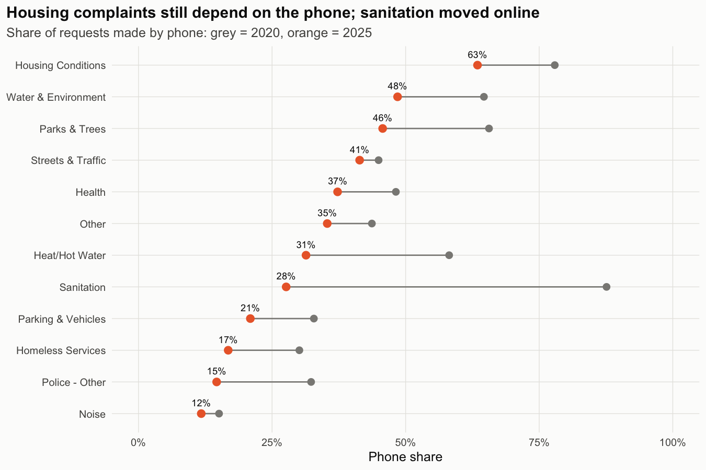

### 9.3 The Complaint Matters More Than the Place

| Test (2025) | Chi-square | df | Cramér's V |
|---|---:|---:|---:|
| Channel x complaint family | 668,303 | 22 | 0.314 |
| Channel x borough | 65,563 | 8 | 0.098 |

Phone requests cluster in office hours (55% arrive between 09:00 and 17:00), while mobile peaks late in the evening.

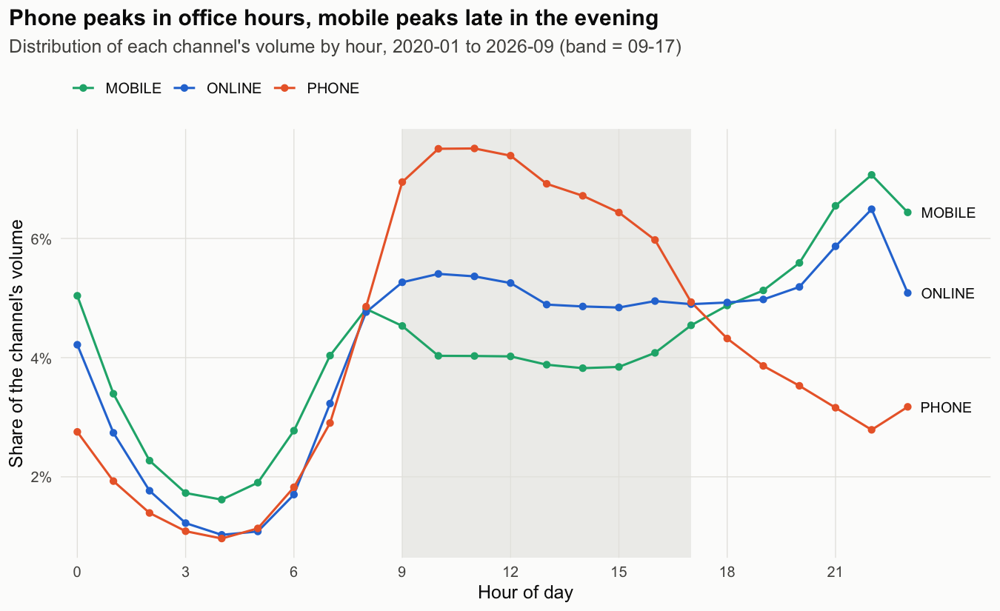

### 9.4 A Few Buildings Distort Borough Comparisons

The top 1% of addresses file 36% of all requests, and 1,323 addresses with more than 1,000 requests each file 15.3%. One Bronx building alone accounts for 1.1% of the dataset. Without these heavy requesters, the Bronx mobile share falls from 33.3% to 20.8%.

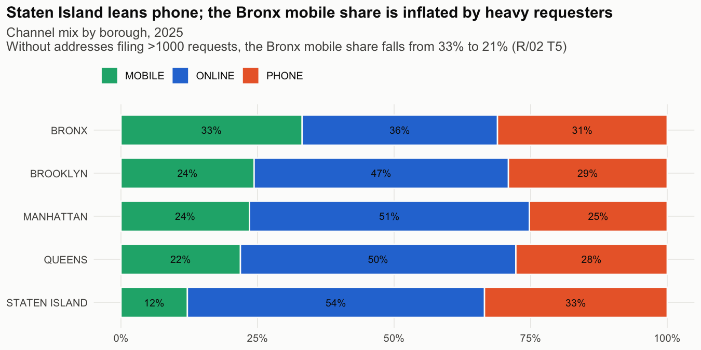

### 9.5 "Mobile Requests Close Faster" Is a Simpson's Paradox

In 2025 the median time to close was 2.1 hours for mobile and 37.6 hours for phone. Within the same complaint type the gap disappears:

| Complaint type (2025) | Mobile (h) | Online (h) | Phone (h) | Epsilon squared |
|---|---:|---:|---:|---:|
| Illegal Parking | 1.6 | 1.4 | 1.6 | 0.0045 |
| Noise - Residential | 1.6 | 1.0 | 1.1 | 0.0125 |
| HEAT/HOT WATER | 35.5 | 41.4 | 39.0 | 0.0054 |

The Kruskal-Wallis tests are significant, but the effect sizes are negligible. After direct standardization, 94.9% to 95.0% of requests close within 7 days on every channel:

| Channel | Closed within 7 days, crude | Standardized |
|---|---:|---:|
| Mobile | 96.3% | 94.9% |
| Online | 95.1% | 95.0% |
| Phone | 92.1% | 94.9% |

Phone looks slow because it carries more housing complaints, which take longer on any channel.

### 9.6 Survival Analysis Agrees

For heat and hot water requests (580,695 in 2024 and 2025, open requests treated as censored), the median time to close is 1.44 days on mobile and 1.64 days on phone and online. The Cox model gives mobile a hazard ratio of 1.19 against phone. Its concordance is only 0.559, so channel and location explain little of the closing time. The proportional hazards test fails for weekend, year and channel, so the hazard ratio is an average over time. A model stratified by weekend and year gives the same channel estimates. The largest difference is in the tail: after 7 days, 1.4% of phone requests are still open against 0.6% online and mobile.

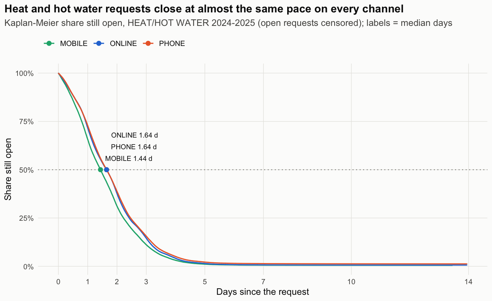

### 9.7 Requesters Keep Their Channel

The next request from the same address uses the same channel 64% to 71% of the time. An address that has always called files 31.8% of its next requests digitally, against 83.2% for an always-digital address. The habit does change slowly: addresses whose first request in 2020 was a phone call filed 64.5% of their 2025 requests digitally.

### 9.8 A Logistic Regression Confirms It

With complaint family, borough, time and year held fixed, an always-digital history multiplies the odds of a digital request by 3.22 and an always-phone history by 0.44 (reference: first request).

| Model | Parameters | McFadden R² | AUC |
|---|---:|---:|---:|
| M1: segment + time | 27 | 0.140 | 0.748 |
| M2: M1 + address history | 31 | 0.191 | 0.787 |

The model is a grouped binomial GLM: 17.2M requests represented by 16,710 cells, with the same coefficients as a row-level fit.

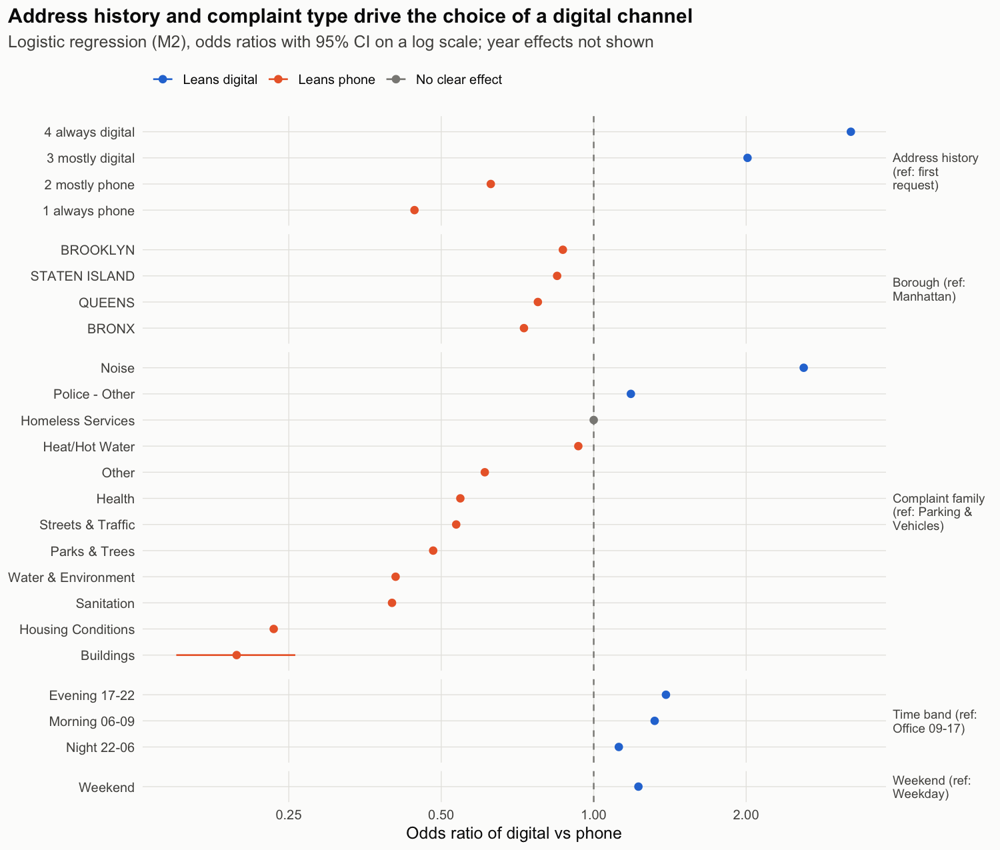

### 9.9 Predicting Phone Requests

Test set: 2025-01 to 2026-09, never seen in training.

| Model | ROC AUC | PR AUC (phone) | Log loss | Brier |
|---|---:|---:|---:|---:|
| Baseline: complaint type rate | 0.747 | 0.536 | 0.507 | 0.165 |
| Logistic regression (one-hot) | 0.827 | 0.677 | 0.432 | 0.135 |
| LightGBM without address history | 0.763 | 0.561 | 0.491 | 0.160 |
| LightGBM (all features) | 0.877 | 0.769 | 0.366 | 0.117 |

Ranking requests by predicted phone probability, the top 10% contain 35% of all phone requests, 3.5 times what random targeting would catch. The top 20% contain 56% and the top 30% contain 72%.

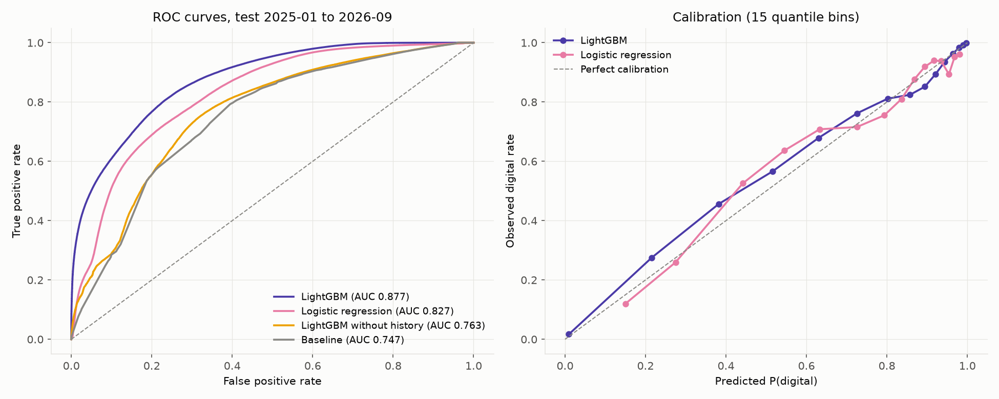

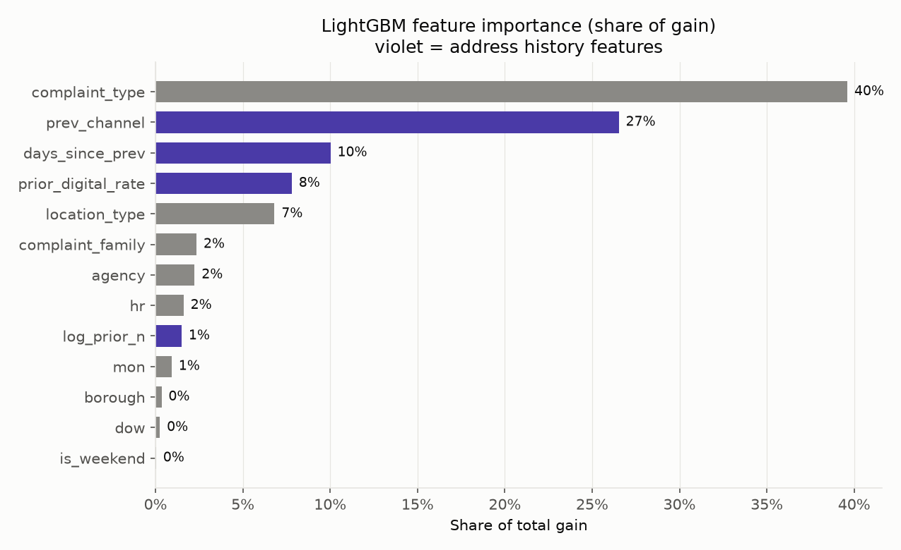

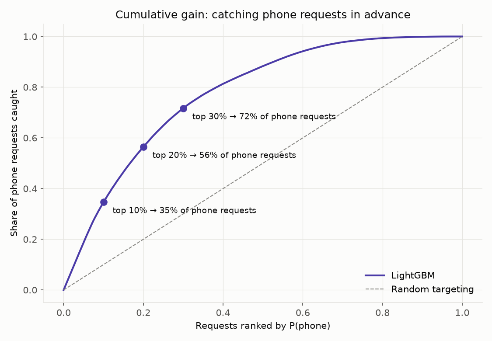

### 9.10 Monitoring Caught Concept Drift, and Retraining Alone Did Not Fix It

Scoring September 2026 with the first model gave a calibration gap of -5.6 points while the score PSI stayed at 0.045. The features had barely moved, but their relationship to the outcome had. Four candidates were compared on the 2026-01 to 2026-09 holdout:

| Candidate | ROC AUC | Log loss | Brier | Calibration gap (pp) |
|---|---:|---:|---:|---:|
| A: champion v1 | 0.871 | 0.364 | 0.116 | -3.37 |
| B: champion + static Platt | 0.871 | 0.360 | 0.114 | -2.32 |
| C: challenger | 0.883 | 0.353 | 0.113 | -4.60 |
| D: challenger + rolling Platt | 0.883 | 0.344 | 0.109 | -0.65 |

The retrained model ranked better but stayed miscalibrated, because the shift to digital continued after its training window. The rolling Platt calibration, refitted each month on the three previous months, passed the promotion rule (lowest log loss and |gap| < 3 points). With the promoted model, September 2026 scores at -1.12 points and PSI 0.039, inside both alert limits.

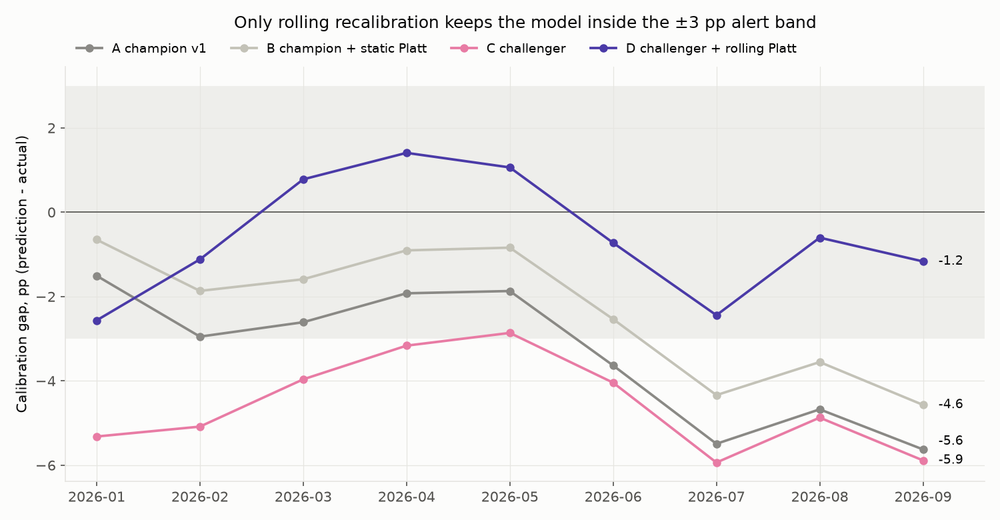

### 9.11 Phone Demand Forecast

Six rolling folds of 28 days, 2026-04-16 to 2026-09-30:

| Model | MAE | WAPE | Bias |
|---|---:|---:|---:|
| LightGBM (direct, 28 days ahead) | 296.1 | 12.2% | +5.1% |
| Seasonal naive (28 days) | 320.0 | 13.2% | +2.2% |
| Yearly naive (364 days) | 423.9 | 17.5% | +11.7% |

The gain is modest. The model over-forecasts by about 5% because the phone series keeps falling, and it misses event-driven spikes: the July 2026 fold has a WAPE of 22.7% against 15.4% for the naive forecast. The 80% interval covers 79.8% of backtest days.

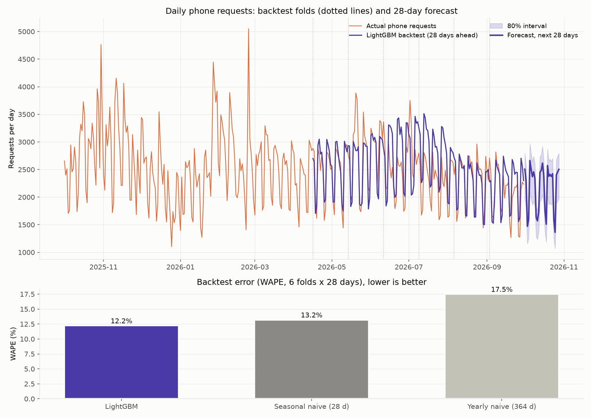

### 9.12 Limitations

- The dataset has no person ID. `requester_key` is a building (BBL) or a zip code plus address, so the behavior results describe buildings, not households.
- 8.6% of requests have an UNKNOWN or OTHER channel and are left out of the channel analysis. 81% of them come from two agencies: all of DOB and 60% of DOT. Building complaints are therefore not represented in the channel results.
- October 2026 holds only five days and is left out of trends and forecasts.
- The regressions describe associations. Whether nudging phone-heavy segments toward digital channels changes their behavior would need a randomized test.
- The phone forecast uses only the series' own history. Weather and event data would be the next step for the spikes it misses.
- Spark runs in local mode on a single 16 GB machine, with an embedded Derby metastore. It shows that the queries and the partitioned layout work in Spark SQL and Hive, not how they behave on a multi-node cluster.

## 10. Tech Stack

### 10.1 Core Technologies

- **Database:** PostgreSQL 18 (range partitioning, window functions, UNLOGGED tables)
- **Statistics:** R 4.x
- **Machine Learning:** Python 3.11+, scikit-learn, LightGBM
- **Big Data:** PySpark 4.2, Spark SQL, Hive metastore (embedded Derby), Parquet
- **Runtime:** Java 17 for Spark; Spark in local mode

### 10.2 Libraries & Dependencies

| Library | Version | Purpose |
|---------|---------|---------|
| pandas | 2.3.3 | Data frames for modeling and scoring |
| numpy | 2.5.3 | Array operations, metrics |
| scikit-learn | 1.9.0 | Logistic regression pipeline, Platt calibration, metrics |
| lightgbm | 4.6.0 | Channel model and demand forecast |
| matplotlib | 3.11.2 | Model, forecast and monitoring figures |
| SQLAlchemy | 2.0.39 | PostgreSQL connection |
| psycopg2-binary | 2.9.13 | PostgreSQL driver, `COPY` for batch scores |
| joblib | 1.6.0 | Model files |
| pyspark | 4.2.0 | Spark SQL and Hive data layer |
| R: survival | 3.8.6 | Kaplan-Meier, Cox, `cox.zph` |
| R: ggplot2 | 4.0.3 | Channel mix, odds ratio and survival figures |
| R: dplyr, tidyr, purrr, forcats | 1.2.1, 1.3.2, 1.2.2, 1.0.1 | Data handling |
| R: broom | 1.0.13 | Model tables |
| R: scales | 1.4.0 | Axis and label formats |
| R: readr, jsonlite | 2.2.0, 2.0.0 | CSV tables, shared palette file |
| R: DBI, RPostgres | 1.3.0, 1.4.10 | PostgreSQL connection |

### 10.3 Algorithm Components

| Component | Method | Purpose |
|-----------|--------|---------|
| Association | Chi-square + Cramér's V | Compare how much complaint type and borough explain channel |
| Group comparison | Kruskal-Wallis + epsilon squared, Holm-corrected Wilcoxon | Resolution time by channel within a complaint type |
| Confounding | Stratification + direct standardization | Separate the channel effect from the complaint mix |
| Survival | Kaplan-Meier, log-rank, Cox, stratified Cox | Time to close with open requests censored |
| Channel choice | Grouped binomial GLM | Odds ratios on 17.2M requests in 16,710 cells |
| Prediction | LightGBM with time-based split | Phone probability per request |
| Monitoring | PSI, calibration gap | Detect covariate and concept drift |
| Recalibration | Rolling Platt scaling | Keep probabilities calibrated as the channel mix moves |
| Forecast | Direct LightGBM on a detrended target | 28-day phone demand for staffing |

### 10.4 Module Overview

| File | Lines | Responsibility |
|------|-------|-----------------|
| `python/01_channel_model.py` | ~181 | Baseline, logistic regression, LightGBM, ablation, three model figures |
| `sql/01_ingest.sql` | ~173 | Database, raw load, typed and partitioned core table |
| `python/02_phone_forecast.py` | ~152 | 28-day forecast, rolling-origin backtest, forecast figure |
| `python/04_retrain.py` | ~144 | Champion/challenger comparison, promotion, calibration gap figure |
| `spark/01_csv_to_parquet.py` | ~143 | Hive table partitioned by year, cleaning parity |
| `python/common.py` | ~149 | Connection, features, prediction, model registry |
| `sql/03_channel_mix.sql` | ~132 | Channel marts and window-function queries |
| `sql/02_data_quality.sql` | ~123 | Derived-field view and data quality report |
| `python/03_batch_scoring.py` | ~120 | Monthly scoring, monitoring, outreach list |
| `R/03_channel_choice_model.R` | ~115 | Grouped logistic regression, odds ratio figure |
| `R/01_channel_mix.R` | ~113 | Four channel mix figures |
| `sql/05_requester_behavior.sql` | ~108 | Requester history and ML sample |
| `spark/session.py` | ~106 | Spark session and PostgreSQL parity helper |
| `spark/02_channel_mix.py` | ~103 | Channel marts in Spark SQL |
| `R/02_hypothesis_tests.R` | ~101 | Hypothesis tests with effect sizes |
| `R/04_survival.R` | ~98 | Kaplan-Meier, Cox, proportional hazards check, survival figure |
| `sql/04_resolution_time.sql` | ~88 | Stratified and standardized resolution time |
| `spark/03_requester_history.py` | ~85 | Requester history in Spark SQL |
| `R/00_setup.R` | ~66 | Shared R setup |
| `run_all.sh` | ~59 | Runs the 17 steps in order, `--fresh` rebuild, step run times |

## 11. License

This project is licensed under the [Creative Commons Attribution-NonCommercial-NoDerivatives 4.0 International (CC BY-NC-ND 4.0)](https://github.com/kemalkilicaslan/NYC311-Service-Channel-and-Requester-Behavior-Analytics-System/blob/main/LICENSE).

The 311 data is not redistributed. It stays under the terms of use of [NYC Open Data](https://opendata.cityofnewyork.us/).

## 12. References

1. NYC Open Data. [311 Service Requests from 2020 to Present](https://data.cityofnewyork.us/Social-Services/311-Service-Requests-from-2020-to-Present/erm2-nwe9).
2. Cramér, H. (1946). *Mathematical Methods of Statistics*. Princeton University Press.
3. Kruskal, W. H., & Wallis, W. A. (1952). [Use of Ranks in One-Criterion Variance Analysis](https://doi.org/10.1080/01621459.1952.10483441). *Journal of the American Statistical Association*.
4. Kaplan, E. L., & Meier, P. (1958). [Nonparametric Estimation from Incomplete Observations](https://doi.org/10.1080/01621459.1958.10501452). *Journal of the American Statistical Association*.
5. Cox, D. R. (1972). [Regression Models and Life-Tables](https://doi.org/10.1111/j.2517-6161.1972.tb00899.x). *Journal of the Royal Statistical Society, Series B*.
6. Grambsch, P. M., & Therneau, T. M. (1994). [Proportional Hazards Tests and Diagnostics Based on Weighted Residuals](https://doi.org/10.1093/biomet/81.3.515). *Biometrika*.
7. Platt, J. (1999). Probabilistic Outputs for Support Vector Machines and Comparisons to Regularized Likelihood Methods. *Advances in Large Margin Classifiers*.
8. Ke, G., et al. (2017). [LightGBM: A Highly Efficient Gradient Boosting Decision Tree](https://papers.nips.cc/paper/6907-lightgbm-a-highly-efficient-gradient-boosting-decision-tree). *NeurIPS 2017*.
9. PostgreSQL [Table Partitioning](https://www.postgresql.org/docs/current/ddl-partitioning.html) Documentation.
10. Apache Spark [Spark SQL Guide](https://spark.apache.org/docs/latest/sql-programming-guide.html).
11. R [survival](https://cran.r-project.org/package=survival) package.

---

### Acknowledgments

Thanks to the City of New York for publishing the 311 service request data on NYC Open Data, and to the PostgreSQL, R, scikit-learn, LightGBM and Apache Spark communities for the tools this pipeline is built on.

---

**Note:** This project is designed for research and educational purposes. The requester results describe buildings, not people, and the regressions describe associations, not causes. Before using the outreach list or the phone forecast to change service operations, test the effect of outreach with a randomized trial and validate the forecast against event and weather data.
